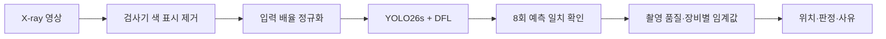

# XGD — X-ray 이물 위치 탐지와 재검사 판정

**작은 이물의 위치를 찾고, 검출 결과를 자동 확정할 수 있는지까지 판단하는 제조 검사 프로젝트입니다.**

제6회 K-인공지능 제조데이터 분석 경진대회 · 팀 딥테크 · XGD-1.2.0

**본인 기여:** 팀 프로젝트의 구현·분석·실험 및 결과 정리 전반을 주도했습니다.

## 문제와 데이터

식품 완제품 X-ray 영상에서 폭 5~21px의 이물을 검출합니다. 검사 장비의 색 표시가 정답 위치의 단서가 되는 문제와, 장비별 해상도·입력 배율 차이를 진단했습니다.

정답이 있는 500장은 개발 356장, 평가 79장, 추가 확인 65장으로 구분했습니다. 평가 79장은 정답을 열지 않고 예측만 제출한 자료이므로, 아래 검증 성능의 평가셋과 구분합니다.

## 접근



검출 결과는 `ACCEPT`, `REVIEW`, `FULL`로 나눕니다. 검출이 없거나 촬영 조건·해상도·실행 환경이 검증 범위를 벗어나면 사람의 재검사를 요청하는 구조입니다.

## 최종 보고서의 결과

아래는 같은 공급처 자료 내 장비 단위 검증의 **seed 17·29·43 평균**입니다. 위치 표시에 맞춰 이물 중심 거리 3px 기준 F1을 사용했습니다.

| 학습에 없던 3호기 설정 | F1@3px | 오탐/장 |
|---|---:|---:|
| YOLO26s, 입력 960 | 0.845 | 0.450 |
| DFL, 입력 960 | 0.942 | 0.170 |
| YOLO26s, 배율 정규화 X8 | 0.923 | 0.230 |
| 최종 XGD 검출기 | **0.988** | **0.037** |

1·2호기 방향의 최종 F1@3px는 0.997, 모델 고정 뒤 추가 확인한 3호기 65장의 F1은 0.995였습니다. 보고서는 검출 완결성 확인 후 '놓친 이물이 자동 확정되는 위험'이 3호기 6.98%에서 0.14%로 줄었다고 기록합니다. 이 값은 해당 시험 조건의 경험적 결과입니다.

## 검증에서 보여줄 점

1. **문제 진단:** 색 표시라는 숨은 단서를 제거하고 흔적·이동·배율 시험을 수행했습니다.
2. **일반화 확인:** 장비 단위 양방향 분할, 촬영일, 열화 17종 및 추가 65장을 구분했습니다.
3. **사용 범위 통제:** 점수를 확률로 간주하지 않고, 예측 간 불일치·품질·장비별 임계값을 판정에 반영했습니다.
4. **재현성:** 최종 보고서에 새 학습 재현, 평가 79장 판정 일치 및 회귀 테스트 89개가 기록되어 있습니다. 이번 정리에서 이를 재실행하지는 않았습니다.

## 공개 코드와 버전

공개 코드는 로컬에 보존된 **2026-10-06 XGD-1.2.0 제출 스냅샷**입니다. 위 결과 소개는 **10월 8일 최종 보고서** 기준입니다. 공개 스냅샷의 테스트 기록은 84개이며, 최종 보고서의 89개 기록과 구분합니다. 최종 Drive ZIP은 다운로드 크기 제한으로 이번 공개본과 바이트 동일성을 확인하지 못했습니다.

[핵심 분석기](src/followup_analyzer.py) · [보류 규칙](src/followup_safety.py) · [전처리](src/preprocess.py) · [DFL 학습](src/train_dfl.py) · [스냅샷 출처](docs/SOURCE_SNAPSHOT.json)

대회 원본 영상·정답, 학습 가중치와 운영 보정 파일은 공개본에 포함하지 않았습니다. 따라서 아래 명령은 해당 자료를 별도로 준비한 전체 제출 환경의 실행 계약입니다. 코드만 clone한 상태의 실행을 보장하지 않습니다.

## 전체 제출 환경의 실행 계약

필요한 디렉터리와 스냅샷 당시 명령은 [원본 실행 안내](docs/SUBMISSION_README_2026-10-06.md)를 참고하세요.

```bash
pip install -r requirements.txt
python run_all.py check
python run_all.py
```

보고서 기준 Python 3.13 환경입니다. 최종 보고서의 `full`·`integration12` 안내와 공개 스냅샷의 `full`·`controls` 경로는 구분해서 읽어야 합니다. 환경·모델·보정 서명이 다르면 자동 확정이 차단됩니다. 이번 공개 정리에서는 학습·추론을 수행하지 않았습니다.

## 한계

정상 제품 영상이 없어 정상/이상 이진 판별 성능은 평가하지 못했습니다. 모든 수치는 같은 공급처 자료의 내부 검증이며 다른 공장·제품으로의 일반화는 미검증입니다. 위험 통제의 교환 가능성 가정은 시험편 ID 부재로 확인하지 못해, 확률적 보장 대신 경험적 운영 기준으로 해석합니다.

출처: 2026-10-08 최종 제출본 「결과보고서_딥테크」. 초기 Phase 보고서의 AP 결과와 최종 XGD 결과는 서로 다른 버전입니다.
